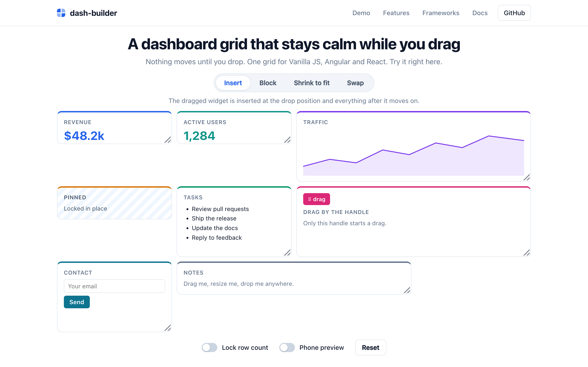
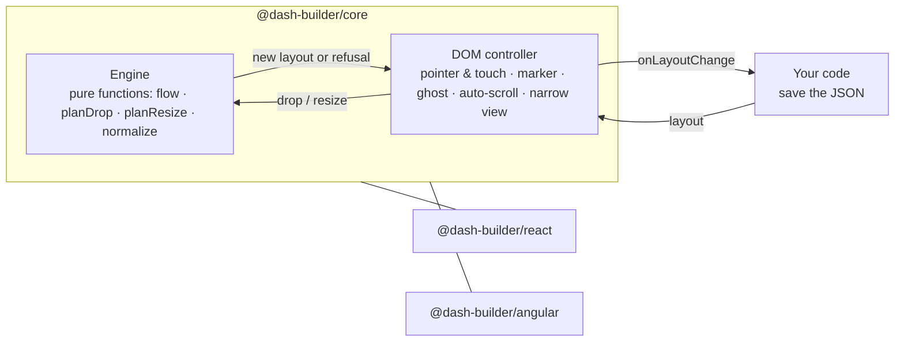

<div align="center">

# dash-builder

**A dashboard grid that stays calm while you drag: framework-agnostic core, Angular and React wrappers.**

[](https://www.npmjs.com/package/@dash-builder/core)
[](https://www.npmjs.com/package/@dash-builder/react)
[](https://www.npmjs.com/package/@dash-builder/angular)
[](https://github.com/Constantine-24/dash-builder/actions/workflows/ci.yml)
[](https://bundlephobia.com/package/@dash-builder/core)
[](packages/core/package.json)
[](LICENSE)

**[Live demo](https://constantine-24.github.io/dash-builder/)** · [Angular demo](https://constantine-24.github.io/dash-builder/angular/) · [React demo](https://constantine-24.github.io/dash-builder/react/) · [Docs](#documentation) · [Contributing](CONTRIBUTING.md)



</div>

## Why dash-builder?

Most dashboard grids shuffle every widget around while you drag, so the layout under the pointer keeps changing and the drop lands somewhere you didn't aim. dash-builder does the opposite: **nothing moves until you drop.** A marker shows where the widget will land (or turns red when the drop is refused), and the layout changes once, on release.

- **Ordered layout, not coordinates.** The layout is a plain JSON array: widgets flow left to right into a fixed number of columns and wrap into rows. No x/y bookkeeping, no overlaps, no holes to clean up, and it serializes as-is.
- **Four drop modes.** `insert`, `block`, `shrink` and `swap` decide how the rest of the dashboard reacts to a drop, and you can switch them at runtime (see [Drop modes](#drop-modes)).
- **Resize under the same rules.** The corner handle resizes in whole cells and respects the drop mode, `minW` / `minH` and the row limit.
- **Built for real dashboards.** Drag handles, locked widgets pinned to their slot, a hard row limit (`maxRows`), form controls that keep working inside widgets, and edge auto-scroll.
- **Mouse and touch.** Handles drag immediately on touch; widgets without one use a long-press, so the page still scrolls.
- **Phone-ready.** Below a breakpoint the grid stacks into one column, and reordering there never overwrites the saved desktop layout.
- **Small and dependency-free.** The core is about 8.6 kB min+gzip with zero dependencies. The Angular and React wrappers are thin: same engine, same CSS, same behaviour.

## Packages

| Package                                                                    | What it is                                                                         |
| -------------------------------------------------------------------------- | ---------------------------------------------------------------------------------- |
| [`@dash-builder/core`](packages/core#readme)                               | The engine and DOM controller: `createGrid()` for vanilla JS/TS, plus `grid.css`.   |
| [`@dash-builder/react`](packages/react#readme)                             | `<Grid>` and `<Widget>` for React 19.                                              |
| [`@dash-builder/angular`](packages/angular/projects/grid-angular#readme)   | `<dash-grid>`, `dashWidget` and `dashHandle` for Angular 22, with or without zone.js. |

## Installation

```bash
npm install @dash-builder/core @dash-builder/react     # React
npm install @dash-builder/core @dash-builder/angular   # Angular
npm install @dash-builder/core                         # vanilla JS/TS, or any other framework
```

Keep every `@dash-builder/*` package on the same version: they are released in lockstep. All three are ESM-only.

| Peer dependency                     | Needed by                          |
| ----------------------------------- | ---------------------------------- |
| `@dash-builder/core`                | both wrappers (`0.x`)              |
| `react`, `react-dom`                | `@dash-builder/react` (`^19`)      |
| `@angular/core`, `@angular/common`  | `@dash-builder/angular` (`^22`)    |

Then import the stylesheet once: `import '@dash-builder/core/grid.css'` (or `@import` it from your global CSS).

## Quick start

You own the layout. The grid renders your widgets from it and hands back a new copy when the user drops or resizes, ready to save.

### React

```tsx
import { useState } from 'react';
import { Grid, Widget, type LayoutItem } from '@dash-builder/react';
import '@dash-builder/core/grid.css';

export function Dashboard() {
  const [layout, setLayout] = useState<LayoutItem[]>([
    { id: 'revenue', w: 2, h: 2 },
    { id: 'users', w: 1, h: 1 },
    { id: 'pinned', w: 1, h: 1, locked: true },
  ]);

  return (
    <Grid columns={4} dropMode="insert" layout={layout} onLayoutChange={setLayout}>
      {layout.map((item) => (
        <Widget key={item.id} id={item.id}>
          <Widget.Handle>{item.id}</Widget.Handle>
          <p>Widget content</p>
        </Widget>
      ))}
    </Grid>
  );
}
```

### Angular

```ts
import { Component, signal } from '@angular/core';
import { DashGrid, DashHandle, DashWidget, type LayoutItem } from '@dash-builder/angular';

@Component({
  selector: 'app-dashboard',
  imports: [DashGrid, DashWidget, DashHandle],
  template: `
    <dash-grid [columns]="4" dropMode="insert" [(layout)]="layout" (layoutChange)="save($event)">
      @for (item of layout(); track item.id) {
        <div [dashWidget]="item.id">
          <header dashHandle>{{ item.id }}</header>
          <p>Widget content</p>
        </div>
      }
    </dash-grid>
  `,
})
export class Dashboard {
  readonly layout = signal<LayoutItem[]>([
    { id: 'revenue', w: 2, h: 2 },
    { id: 'users', w: 1, h: 1 },
    { id: 'pinned', w: 1, h: 1, locked: true },
  ]);

  save(layout: LayoutItem[]) {
    localStorage.setItem('dashboard-layout', JSON.stringify(layout));
  }
}
```

### Vanilla JS / TS

```html
<div id="grid">
  <div data-grid-id="revenue"><span data-grid-handle>⠿</span> Revenue</div>
  <div data-grid-id="users">Active users</div>
  <div data-grid-id="pinned">Pinned</div>
</div>
```

```ts
import { createGrid } from '@dash-builder/core';
import '@dash-builder/core/grid.css';

const grid = createGrid(document.getElementById('grid')!, {
  columns: 4,
  layout: [
    { id: 'revenue', w: 2, h: 2 },
    { id: 'users', w: 1, h: 1 },
    { id: 'pinned', w: 1, h: 1, locked: true },
  ],
  dropMode: 'insert',
  onLayoutChange: (layout) => localStorage.setItem('dashboard-layout', JSON.stringify(layout)),
});

grid.setOptions({ dropMode: 'swap' }); // change anything at runtime
```

## The layout

```ts
interface LayoutItem {
  id: string;       // matches the widget
  w: number;        // width in columns
  h: number;        // height in rows
  minW?: number;
  minH?: number;
  locked?: boolean; // can't be dragged or resized, stays pinned to its index
}
```

Array order is position: items fill each row left to right and wrap when the next one doesn't fit. What `onLayoutChange` gives you is exactly what you pass back in, so saving a dashboard is `JSON.stringify(layout)`.

## Drop modes

| Mode     | What a drop does                                                                                                   |
| -------- | ------------------------------------------------------------------------------------------------------------------ |
| `insert` | The widget is inserted at the drop position and everything after it moves on.                                     |
| `block`  | The drop is refused if it would move any other widget into a different row: every row keeps its widgets.          |
| `shrink` | The widgets in the target row narrow (down to their `minW`) to make room; refused if the row can't fit the widget. |
| `swap`   | The widget trades places with the one it's dropped on.                                                             |

Locked widgets keep their index in every mode, and `maxRows` refuses any drop, resize or `addItem` that would grow the dashboard past the limit. The [core README](packages/core#drop-modes) has the exact rules.

## How it works



The engine is a set of pure functions over the layout array; it never touches the DOM and is exported for server-side or headless use (`planDrop`, `planResize`, `addItem`, `removeItem`, `normalizeLayout`, `computeFlow`, …). The controller places widgets with CSS grid from the computed flow and, during a drag, only draws a marker and a ghost: the layout changes once, on drop. The wrappers create one controller each and translate between it and React props or Angular signals.

## Documentation

- **[@dash-builder/core](packages/core#readme)**: options, the controller API, the DOM contract, drop modes in detail, interaction, styling tokens.
- **[@dash-builder/react](packages/react#readme)**: `<Grid>` props, `<Widget>` and `Widget.Handle`, the imperative handle (`addItem`, `removeItem`), the rules for widgets.
- **[@dash-builder/angular](packages/angular/projects/grid-angular#readme)**: inputs, outputs, `addItem` / `removeItem`, zone.js and zoneless use.
- **[Live demo](https://constantine-24.github.io/dash-builder/)**: try every drop mode, the row limit and the phone view; the Angular and React tabs run the real wrapper packages.

## Compatibility

| Package                 | Requires                                                                 |
| ----------------------- | ------------------------------------------------------------------------ |
| `@dash-builder/core`    | Any evergreen browser (ES2022, CSS grid). No runtime dependencies.       |
| `@dash-builder/react`   | React 19. Safe under `<StrictMode>` and server rendering.                |
| `@dash-builder/angular` | Angular 22, standalone. Works with zone.js and zoneless.                 |

## Limitations

Read these before adopting:

- **No free positioning.** Widgets always flow in list order; there are no empty cells and no x/y placement. That is the design, not a gap.
- **No keyboard reordering yet.** Dragging and resizing need a mouse, pen or touch.
- **Widgets must be direct children of the grid.** In React that means `<Widget>` elements (a wrapper component may render one); in Angular, elements placed directly inside `<dash-grid>`, not through `ngTemplateOutlet`.
- **The phone (narrow) view is temporary.** Reordering there is not saved and resizing is off.
- **RTL** layouts are untested.

## Contributing

Bug reports and pull requests are welcome; see [CONTRIBUTING.md](CONTRIBUTING.md). In short:

```bash
corepack enable && pnpm install
pnpm build && pnpm test
```

Releases are automated with [Changesets](https://github.com/changesets/changesets) and published to npm with provenance.

## License

[MIT](LICENSE)
